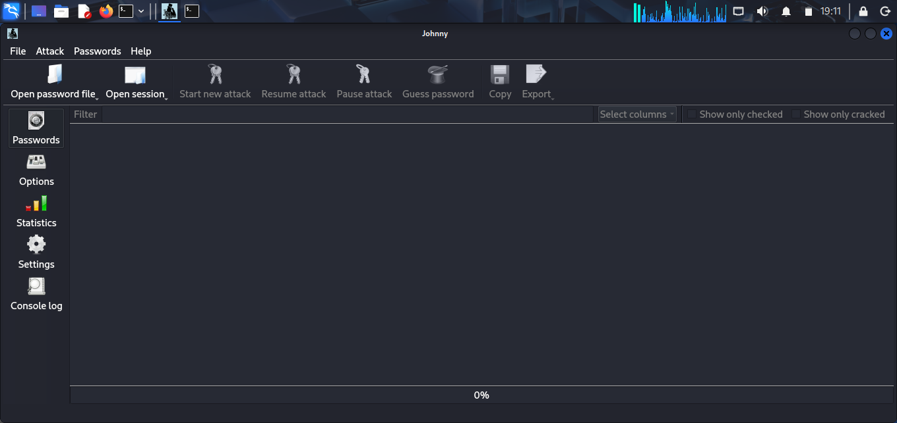
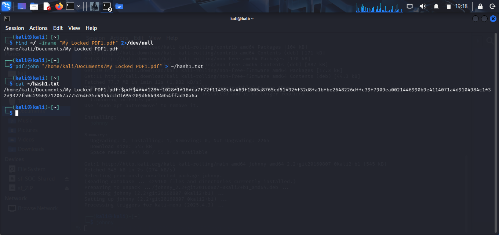
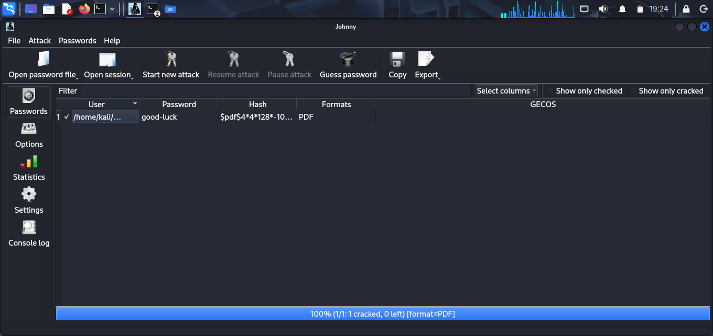
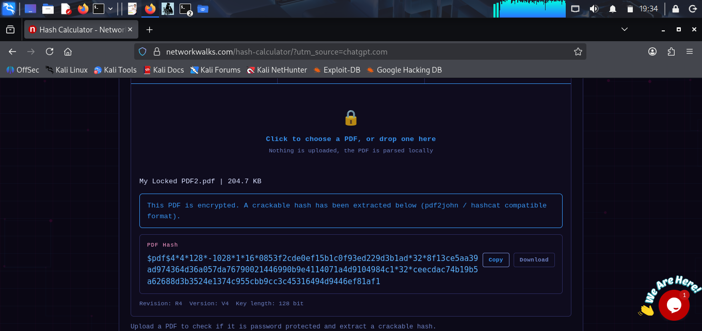
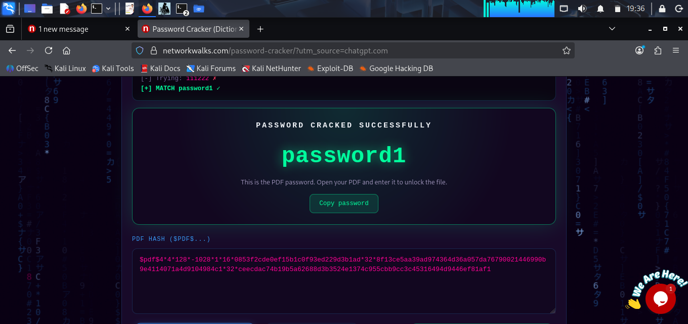
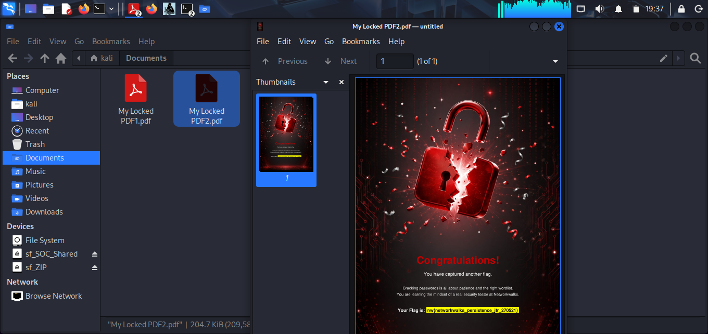

# Week 3: Password Cracking – Project Modules 1 & 2

## 1. Project Overview

This project involved two practical exercises focused on password recovery from encrypted PDF documents.

The exercises demonstrated two approaches to password cracking:

- Using John the Ripper (JTR) and its graphical interface, Johnny.
- Using Networkwalks online Hash Calculator and Password Cracker tools.

Both exercises were performed in a Kali Linux environment.

## 2. Objectives

The objectives of these exercises were to:

- Understand how password cracking works.
- Extract password hashes from encrypted PDF documents.
- Use John the Ripper to recover PDF passwords.
- Understand how to use a graphical interface for password cracking.
- Use online password-cracking tools.
- Verify recovered passwords by opening the protected PDF documents.

## 3. Lab Environment

| Component | Details |
|---|---|
| Operating System | Kali Linux |
| John the Ripper | 1.9.0 Jumbo |
| Graphical Interface | Johnny |
| Hash Extraction Utility | pdf2john |
| Web Browser | Firefox |
| Online Tools | Networkwalks Hash Calculator and Password Cracker |
| Target Files | My Locked PDF1.pdf and My Locked PDF2.pdf |

---

# MODULE 1: PASSWORD CRACKING WITH JOHN THE RIPPER

## 4. Introduction

John the Ripper is a password security auditing and recovery tool used to test password strength. It supports different password hash formats and can be used to recover passwords from protected files.

Johnny provides a graphical interface for interacting with John the Ripper.

In this exercise, John the Ripper and Johnny were used to recover the password of an encrypted PDF document.

## 5. Installation and Configuration

John the Ripper was already available in the Kali Linux environment.

The installed version was verified using the terminal.

**Version:** John the Ripper 1.9.0 Jumbo

**Executable location:**
`/usr/sbin/john`

The PDF hash extraction utility was also available at:

- `/usr/bin/pdf2john`
- `/usr/share/john/pdf2john.pl`

Johnny was installed using the Kali package manager:

```bash
sudo apt update
sudo apt install johnny -y
```

After installation, Johnny was launched and its configuration was checked. It automatically detected the John executable at `/usr/sbin/john`.

### Screenshot Evidence



## 6. PDF Hash Extraction

The target document was:

`My Locked PDF1.pdf`

The PDF was located in the Kali Documents directory.

The `pdf2john` utility was used to extract the password hash.

Command executed:

```bash
pdf2john "/home/kali/Documents/My Locked PDF1.pdf" > ~/hash1.txt
```

The extracted hash was saved in `hash1.txt`.

The file was checked using:

```bash
cat ~/hash1.txt
```

The extracted hash began with `$pdf$`, indicating the PDF hash format.

### Screenshot Evidence



## 7. Password Recovery Using Johnny

Johnny was opened and the extracted hash file was loaded through the **Open password file** option.

The file `hash1.txt` was selected.

John the Ripper processed the hash, and Johnny displayed:

**1/1 cracked — 100%**

The recovered password was:

`good-luck`

### Screenshot Evidence



## 8. Password Verification

The original encrypted PDF was opened, and the recovered password was entered.

The PDF opened successfully, confirming that the recovered password was correct.

### Screenshot Evidence


---

# MODULE 2: PASSWORD CRACKING WITH NETWORKWALKS TOOLS

## 9. Introduction

This exercise involved using two browser-based tools provided by Networkwalks:

1. Hash Calculator
2. Password Cracker

The tools were used to extract a password hash from an encrypted PDF and recover its password.

Unlike Module 1, this exercise did not require installing a password-cracking application.

## 10. Hash Extraction Using Networkwalks Hash Calculator

The target document for this exercise was:

`My Locked PDF2.pdf`

The Networkwalks Hash Calculator was opened in Firefox.

Website:

https://networkwalks.com/hash-calculator/

The encrypted PDF was uploaded to the calculator.

The tool identified the document as encrypted and generated a crackable hash in pdf2john/hashcat-compatible format.

The extracted hash began with:

`$pdf$4*4*128`

The complete hash was copied for the next stage.

**PDF encryption details returned by the calculator:**

- Revision: R4
- Version: V4
- Key length: 128 bits

### Screenshot Evidence



## 11. Password Recovery Using Networkwalks Password Cracker

The Networkwalks Password Cracker was opened in Firefox.

Website:

https://networkwalks.com/password-cracker/

The complete PDF hash extracted from the Hash Calculator was pasted into the password input field.

The cracking process was started, and the tool attempted to identify the original password.

The recovered password was:

`password1`

### Screenshot Evidence



## 12. Password Verification

The original encrypted document, `My Locked PDF2.pdf`, was opened in Kali Linux.

The recovered password was entered into the PDF password prompt.

The document opened successfully, confirming that the password recovery was successful.

### Screenshot Evidence



---

# 13. Results Summary

| Activity | Module 1 | Module 2 |
|---|---|---|
| Target PDF | My Locked PDF1.pdf | My Locked PDF2.pdf |
| Hash Extraction | pdf2john | Networkwalks Hash Calculator |
| Cracking Tool | John the Ripper | Networkwalks Password Cracker |
| GUI | Johnny | Web Interface |
| Password Recovered | good-luck | password1 |
| PDF Verification | Successful | Successful |

Both exercises successfully recovered the passwords of their respective encrypted PDF documents.

## 14. Lessons Learned

The exercises provided practical experience in the following areas:

- Extracting password hashes from encrypted PDF documents.
- Understanding the role of hash formats in password recovery.
- Using John the Ripper through both command-line and graphical interfaces.
- Working with browser-based password recovery tools.
- Understanding how weak or predictable passwords can be recovered.
- Verifying password recovery against the original protected document.

The exercises also demonstrated that password complexity plays an important role in password security.

## 15. Security Considerations

Password cracking tools can be used for legitimate security testing and password auditing.

However, these tools should only be used on files and systems for which permission has been granted.

The exercises demonstrated why users should avoid weak and predictable passwords and use stronger passwords to protect sensitive information.

## 16. Conclusion

Both Week 3 password-cracking exercises were completed successfully.

In Module 1, John the Ripper and Johnny were used to extract and recover the password of an encrypted PDF document.

In Module 2, the Networkwalks Hash Calculator and Password Cracker were used to perform the same process through browser-based tools.

In both cases, the recovered passwords successfully opened their respective PDF documents.

These exercises provided practical exposure to password hash extraction, password recovery techniques, and the importance of strong password protection.

---


**Note:** The original encrypted PDF files and extracted hash files are not included in this suggested public repository structure.
